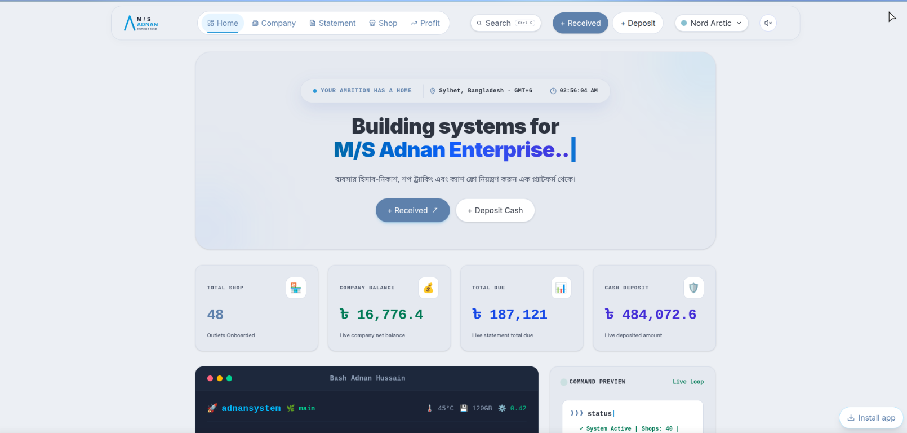
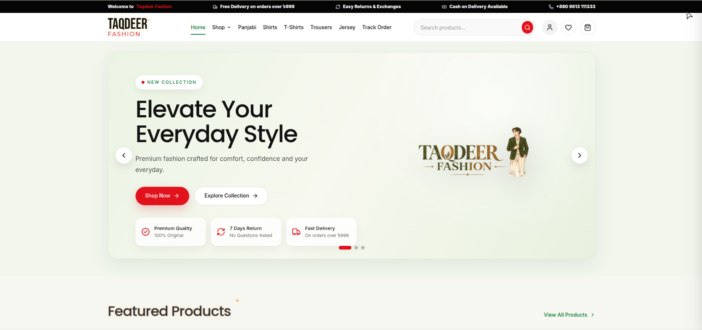

<div align="center">
  

  <h1>Md. Adnan Hussain</h1>
  <p><strong>Full-Stack Web Developer · Sylhet, Bangladesh</strong></p>

  <p>
    <a href="https://adnanhussain.dev">Portfolio</a> ·
    <a href="mailto:itadnanhussain@gmail.com">Email</a> ·
    <a href="https://github.com/itadnanhussain">GitHub</a> ·
    <a href="https://www.linkedin.com/in/itadnanhussain/">LinkedIn</a>
  </p>

  <p>
    
    
    
    
  </p>
</div>

## About

I build responsive, production-ready web applications with a focus on thoughtful user experiences, reliable backend systems, and maintainable code. My work includes business management software, e-commerce, REST APIs, and data-driven applications using Next.js, TypeScript, Supabase, and PostgreSQL.

## Featured projects

### M/S Adnan Enterprise

A live dealer accounting and management platform for company transactions, shop ledgers, sales statements, and daily profit tracking.



**Built with:** Next.js · React · TypeScript · Supabase · PostgreSQL · Tailwind CSS

[Open live application](https://adnan-enterprise.vercel.app/) · [View source](https://github.com/itadnanhussain/adnan-enterprise)

### Taqdeer Fashion

A fashion retail experience with a product catalogue, inventory tools, order tracking, and a responsive shopping interface.



**Built with:** Next.js · React · TypeScript · Tailwind CSS · PostgreSQL · Prisma

[View source](https://github.com/itadnanhussain/Taqdeer-Fashion)

## Tech stack

| Area | Technologies |
| --- | --- |
| Frontend | React, Next.js App Router, TypeScript, Tailwind CSS |
| Backend & data | Node.js, REST APIs, Supabase, PostgreSQL, Prisma |
| Tools & deployment | Git, GitHub, Vercel |

## Run locally

### Requirements

- Node.js 20.9 or newer
- npm

### Setup

```bash
git clone https://github.com/itadnanhussain/adnan-portfolio-2.0.git
cd adnan-portfolio-2.0
npm ci
npm run dev
```

Open [http://localhost:3000](http://localhost:3000) to view the portfolio. No environment variables are required for the portfolio itself.

## Validation and production

```bash
npm run lint
npx tsc --noEmit
npm run build
```

The downloadable resume is served from [`/resume.pdf`](./public/resume.pdf). The project can be deployed to Vercel with the default Next.js build settings; use the repository root as the project root.

## Contact

- **Email:** [itadnanhussain@gmail.com](mailto:itadnanhussain@gmail.com)
- **GitHub:** [@itadnanhussain](https://github.com/itadnanhussain)
- **LinkedIn:** [Md. Adnan Hussain](https://www.linkedin.com/in/itadnanhussain/)

---

<div align="center">
  <sub>Designed and built by Md. Adnan Hussain · Sylhet, Bangladesh</sub>
</div>
